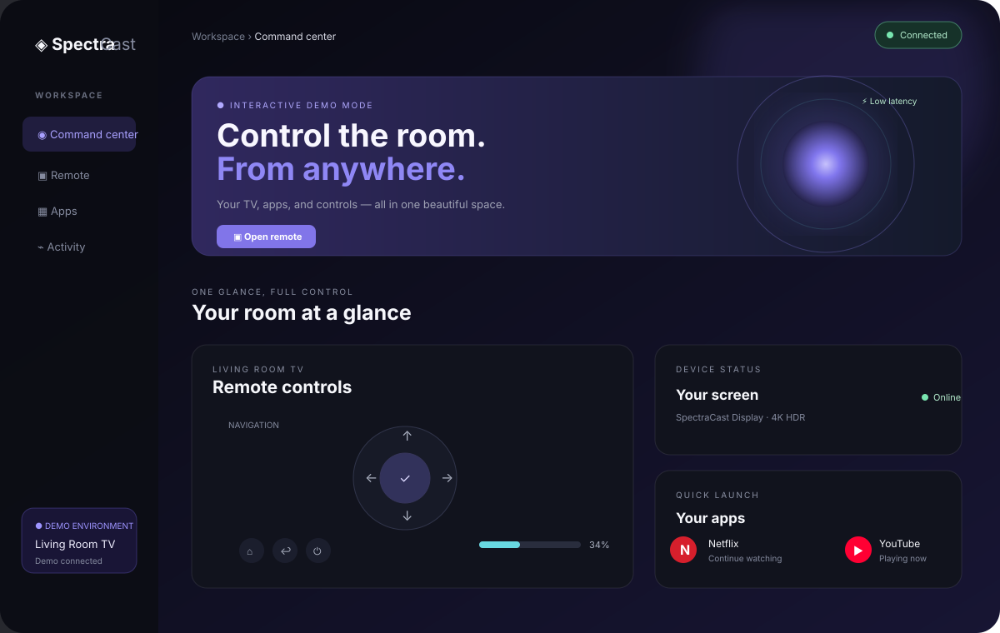
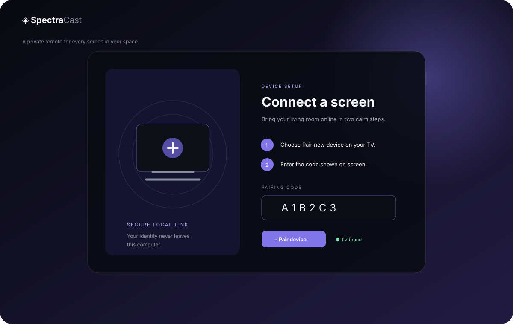
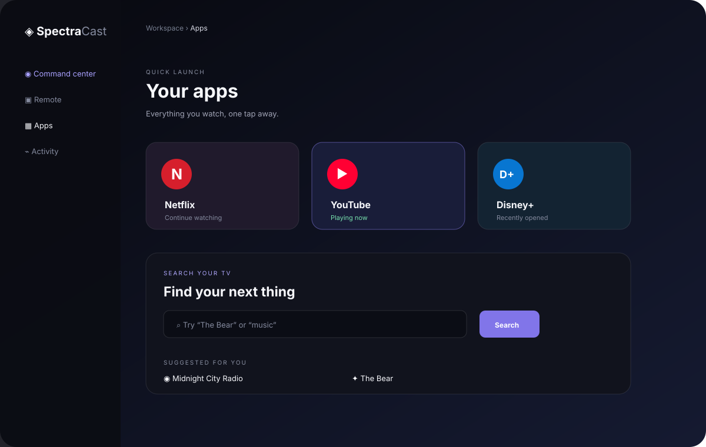
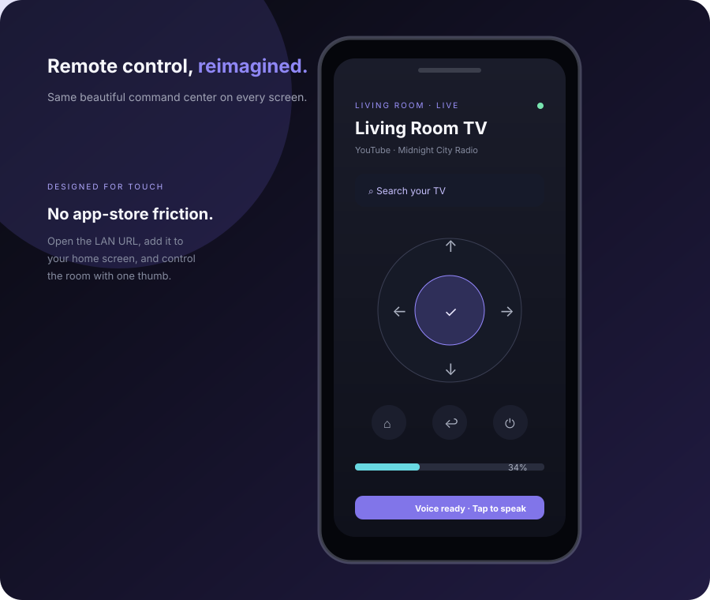

# SpectraCast Remote

> A beautiful, private command center for every Android TV in your home.

SpectraCast turns any modern browser into a polished Android TV remote. Run the
small local service on a computer that can see your TV, then use the responsive
web app from that computer, a phone, a tablet, or a living-room browser. No
account, cloud relay, ADB setup, or developer mode is required.



## Why SpectraCast?

- **One local service, every screen** — Windows, macOS, Linux, iOS, Android,
  and tablets use the same responsive browser interface.
- **Fast setup** — one launcher creates the Python environment, installs the
  service, starts the interface, and opens the browser.
- **Private by default** — the service binds to `127.0.0.1` unless LAN access
  is explicitly enabled. TV certificates and pairing state stay on the host.
- **A real remote, not a mockup** — navigation, power, playback, volume,
  text entry, app launching, pairing, state updates, and reconnect-safe device
  sessions are implemented behind the API.
- **Made for touch** — the same command center adapts to a phone-sized screen
  and can be installed as a PWA from Safari, Chrome, or another modern browser.
- **Demo mode included** — explore the UI or capture product screenshots with
  no TV connected.

## The 60-second setup

### Option A — one-click launcher

1. Install Python 3.10 or newer on the computer that is on the same network as
   your TV.
2. Run the launcher for your operating system:

   **macOS / Linux**

   ```sh
   ./scripts/start.sh
   ```

   **Windows PowerShell**

   ```powershell
   .\scripts\start.ps1
   ```

   **Windows Command Prompt**

   ```bat
   scripts\start.cmd
   ```

3. The launcher prints a local URL and opens the command center. To use a
   phone or tablet, open the printed `http://<computer-ip>:8765/` URL on the
   same Wi-Fi network.
4. Select **Pair a device**. SpectraCast discovers Android TV Remote Service
   endpoints automatically, asks the TV to display a pairing code, and stores
   the resulting identity in the protected `.spectradata/` directory.

The first run downloads Python packages. Every later run reuses the local
virtual environment and starts quickly.

### Option B — direct command

```sh
python3 -m venv .venv
. .venv/bin/activate                 # Windows: .venv\Scripts\activate
python -m pip install -e .
python -m spectracast --lan
```

Use `--lan` when a phone or tablet needs to connect. Without it, the service is
loopback-only and can only be opened on the host computer.

### Option C — try the interface without a TV

```sh
python -m spectracast --demo --no-browser
```

Open `http://127.0.0.1:8765/?demo=1`. Demo mode keeps all actions in the
browser and is useful for evaluating the UX, CI smoke tests, and screenshots.

## Requirements and compatibility

### Host computer

- Python **3.10+**
- A network connection shared with the Android TV
- Windows 10+, macOS 12+, or a current Linux distribution

### Client devices

The client is a standards-based web app and does not need an app-store install:

- Chrome / Edge / Firefox / Safari on desktop
- Safari on iPhone and iPad
- Chrome or another current browser on Android phones and tablets
- Modern Chromium-based TV and kiosk browsers

The client device and host computer must be able to reach the host's LAN IP.
Some guest Wi-Fi networks block device-to-device traffic; use a normal home
network or configure that network to allow local clients.

### TV

The TV must expose the Android TV Remote Service, which is preinstalled on most
Android TV / Google TV devices. The service uses the secure Android TV Remote
protocol and does not use ADB.

If automatic discovery cannot find the TV, start the service with its address:

```sh
python -m spectracast --lan --tv-host 192.168.1.42 --tv-name "Living Room TV"
```

The two protocol ports are `6466` for remote commands and `6467` for pairing.

## The cross-device model

SpectraCast is intentionally a **local-first web application**:

```text
Phone / tablet / desktop browser
              │ same-origin HTTP + WebSocket
              ▼
SpectraCast service on a computer in the home
              │ TLS Android TV Remote protocol
              ▼
Android TV / Google TV
```

The browser never receives the TV client private key. This is what makes the
same experience practical on iOS and Android while keeping pairing state under
the user's control.

## Feature tour

### Command center

- Animated room overview with connection health
- Tactile D-pad, Home, Back, Power, playback, volume, and mute controls
- Live current app, power, and volume state when the TV reports it
- Quick-launch cards for Netflix, YouTube, Disney+, and Spotify
- Search drawer and keyboard shortcut (`⌘ K` / `Ctrl K`)
- Voice session controls when negotiated by the device
- WebSocket state events for responsive updates across open browsers

### Pairing and identity

The first pairing generates a unique RSA client identity. It is held in memory
while the service is running and persisted only when the file-backed store is
used. The default store is:

```text
.spectradata/
└── identity.json       # owner-readable mode 0600; contains certificate + key
```

The directory is created with mode `0700`, writes are atomic, and the pairing
PIN and derived secret are never written to logs or disk. Delete `.spectradata`
to forget all pairings and start fresh.

### Install as an app

When opened from the LAN URL, use the browser's **Add to Home Screen** or
**Install SpectraCast** action. The included manifest and service worker make
the command center feel like a native remote while all commands still go to
your local service.

## API

The service serves a small same-origin JSON API. See [docs/API.md](docs/API.md)
for request and response details.

```text
GET  /api/health
GET  /api/status
GET  /api/devices
POST /api/discover
POST /api/pair/start
POST /api/pair
POST /api/session/connect
POST /api/session/disconnect
POST /api/remote/key
POST /api/remote/text
POST /api/apps/launch
POST /api/search
POST /api/voice
GET  /api/events                 WebSocket state stream
```

Example:

```sh
curl http://127.0.0.1:8765/api/status
curl -X POST http://127.0.0.1:8765/api/remote/key \
  -H 'content-type: application/json' \
  -d '{"key":"HOME"}'
```

## Development

Create the host environment and install test tooling:

```sh
python3 -m venv .venv
. .venv/bin/activate
python -m pip install -e ".[test]"
```

Run the backend checks:

```sh
pytest -q
ruff check src tests
ruff format --check src tests
mypy src/spectracast
```

Build the browser bundle:

```sh
cd frontend
npm ci
npm run build
```

The Vite build is emitted into `src/spectracast/web/dist/` so an installed
Python package can serve the UI without requiring Node.js at runtime.

Start the development UI with hot reload when working on the frontend:

```sh
cd frontend
npm run dev
```

Use `?demo=1` for a stable visual state. The UI uses relative `/api/...` URLs,
so it works behind the bundled service, a reverse proxy, or a local Vite
development proxy.

## Screenshots

| Command center | Pairing flow |
| --- | --- |
|  |  |

| App launcher | Mobile remote |
| --- | --- |
|  |  |

The checked-in SVG previews are lightweight, deterministic product boards that
render reliably on Git hosting and in offline documentation. For a live UI,
run `python -m spectracast --demo` and open the browser shell.

## Troubleshooting

### “No TV found”

- Confirm the host computer and TV are on the same non-guest Wi-Fi.
- Confirm the Android TV Remote Service is enabled in the TV's system apps.
- Try the manual address form through the CLI:

  ```sh
  python -m spectracast --lan --tv-host 192.168.1.42
  ```

- Check that local firewall rules allow outbound TCP connections to ports
  `6466` and `6467`.

### “The device rejected the identity”

The TV may have forgotten the client identity or its Remote Service data may
have been reset. Delete the local `.spectradata/` directory, restart the
service, and pair again. This is intentionally a destructive local reset; it
does not affect the TV's other apps.

### The phone cannot open the page

- Start with `--lan`, not only the default loopback mode.
- Use the LAN URL printed by the launcher, not `localhost` on the phone.
- Disable VPN or client isolation temporarily to test the home network.
- Make sure the host firewall allows the selected HTTP port (`8765` by
  default).

### Voice is unavailable

Voice support depends on the TV advertising the voice feature and on the
device's Android TV Remote Service implementation. Navigation, text, apps,
power, media, and volume do not depend on voice support.

## Privacy and security

- No cloud service or analytics is included.
- The default listener is loopback-only.
- `--lan` is an explicit opt-in and should only be used on a trusted private
  network. Stop the process when you no longer need phone access.
- TV client certificates and the private key are stored under `.spectradata/`
  with owner-only permissions.
- Pairing PINs, derived secrets, and voice payloads are kept out of logs.
- API responses never contain certificate or private-key material.
- The browser stores no pairing credentials in local storage.
- Never expose the service through a public reverse proxy without adding an
  authentication and TLS layer appropriate for that deployment.

Read [SECURITY.md](SECURITY.md) before reporting a security issue.

## Project layout

```text
src/spectracast/
├── server.py             # local HTTP/WebSocket API and CLI
├── device.py             # high-level connection and device lifecycle
├── pairing.py            # secure pairing handshake
├── protocol.py           # branded command/state protocol adapter
├── identity.py           # memory + protected local identity stores
├── discovery.py          # injectable and Zeroconf discovery
├── framing.py            # bounded protobuf frame transport
├── wire/                 # private generated protocol definitions
└── web/dist/             # packaged production browser bundle
frontend/
├── src/main.js           # responsive command center behavior
├── src/styles.css        # visual system and responsive layout
└── public/               # PWA manifest and service worker
tests/                    # protocol, pairing, storage, device, API tests
scripts/                  # cross-platform one-click launchers
docs/                     # architecture, API, troubleshooting, screenshots
```

## Attribution and license

SpectraCast is original application code released under the MIT License. The
Android TV Remote wire schema and interoperability work are documented in
[THIRD_PARTY_NOTICES.md](THIRD_PARTY_NOTICES.md). SpectraCast is not affiliated
with Google, Android, Google TV, Netflix, YouTube, Disney, or Spotify.

See [CONTRIBUTING.md](CONTRIBUTING.md) for the development workflow and
[CHANGELOG.md](CHANGELOG.md) for release notes.
